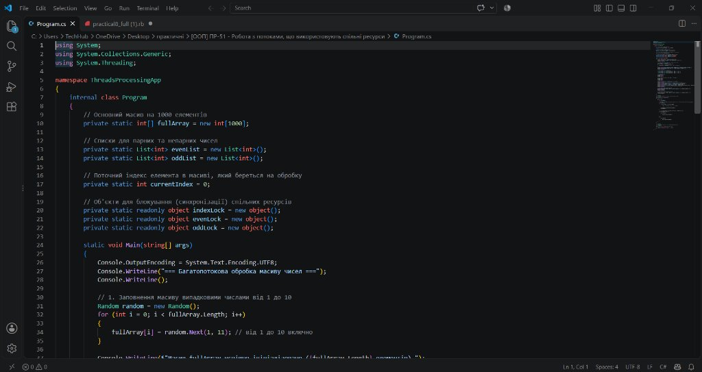
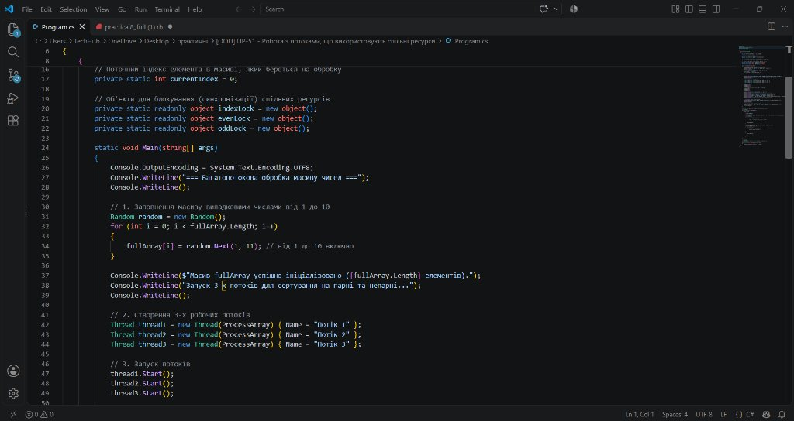
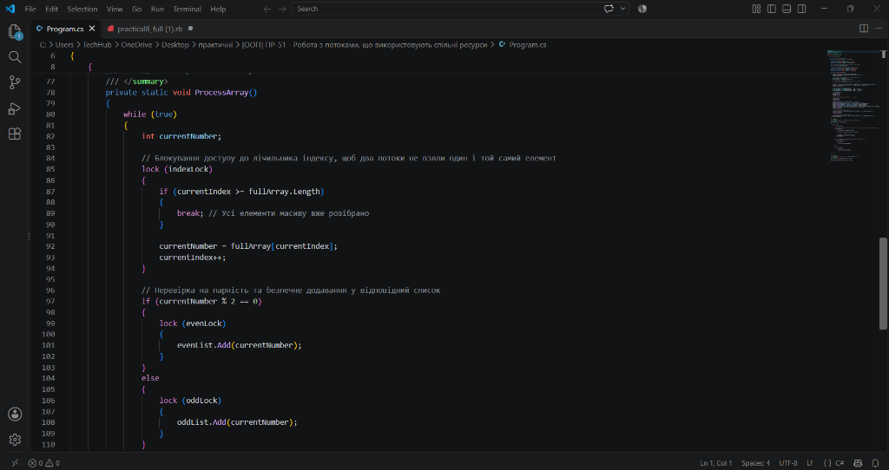
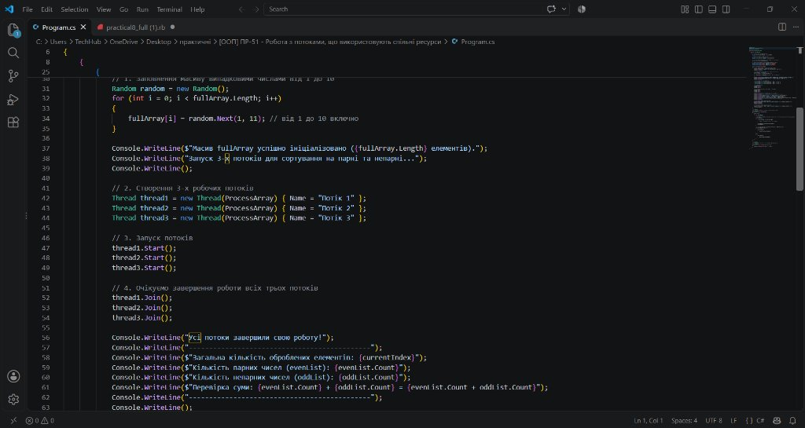
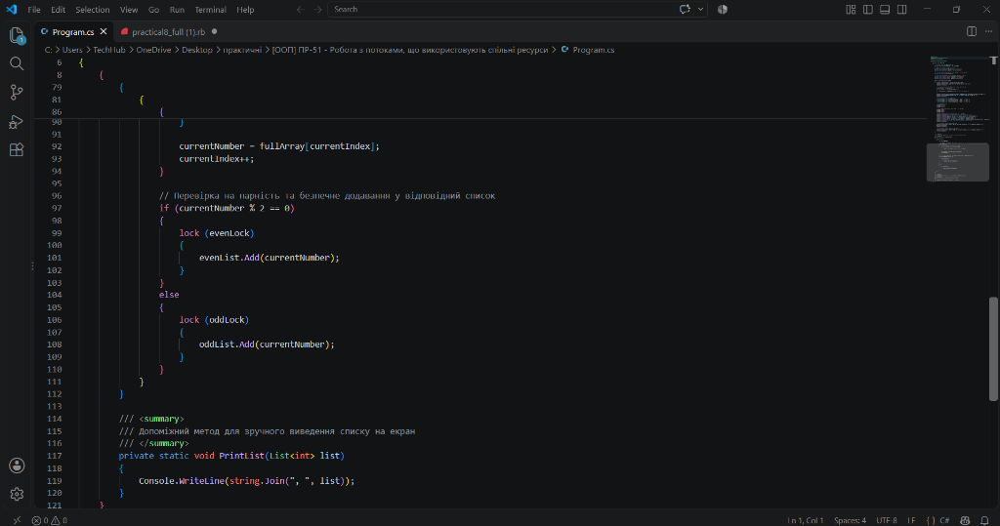
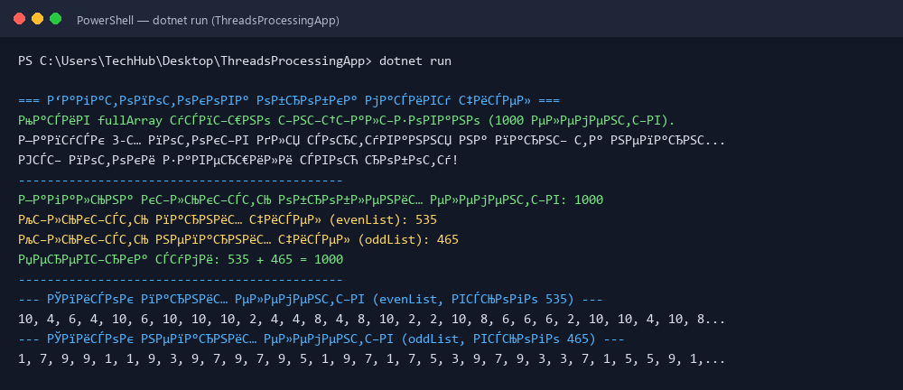

# ПР-51. Робота з потоками, що використовують спільні ресурси

**Тема:** Робота з потоками, що використовують спільні ресурси у C#  
**Мета:** Опанувати механізми синхронізації потоків при одночасному доступі до спільних ресурсів; навчитися використовувати блокування критичних секцій за допомогою оператора `lock` (клас `Monitor`); запобігати виникненню стану гонитви (race condition) та порушенню цілісності даних у багатопотоковому середовищі.

---

## Хід роботи

### Крок 1. Оголошення спільних ресурсів та об'єктів блокування
У класі `Program` створено спільний одновимірний масив `fullArray` на 1000 елементів, списки `evenList` та `oddList` для збереження відсортованих парних і непарних чисел, а також цілочисельний лічильник поточного індексу `currentIndex = 0`.  
Для запобігання стану гонитви (race condition) та забезпечення взаємного виключення при одночасному зверненні кількох потоків створено окремі виділені об'єкти блокування:
* `indexLock` — для блокування доступу до спільного лічильника `currentIndex`;
* `evenLock` — для потокобезпечного додавання елементів у список парних чисел `evenList`;
* `oddLock` — для потокобезпечного додавання елементів у список непарних чисел `oddList`.



---

### Крок 2. Ініціалізація даних та запуск 3-х робочих потоків
У методі `Main()` масив `fullArray` заповнюється 1000 випадковими цілими числами в діапазоні від 1 до 10 включно за допомогою генератора `Random`.  
Після цього створюються три екземпляри класу `Thread` із власними іменами («Потік 1», «Потік 2», «Потік 3»), які виконують спільний метод `ProcessArray`. Потоки переводяться у стан готовності до виконання викликом методу `.Start()`.



---

### Крок 3. Реалізація методу ProcessArray() та захист критичних секцій через lock
Метод `ProcessArray()` містить цикл `while (true)`. Критична секція зчитування поточного числа з масиву та інкременту лічильника `currentIndex` захищена оператором `lock (indexLock)`:
```csharp
lock (indexLock)
{
    if (currentIndex >= fullArray.Length)
    {
        break; // Усі елементи масиву вже розібрано
    }

    currentNumber = fullArray[currentIndex];
    currentIndex++;
}
```
Це забезпечує атомарність операції та гарантує, що жодні два потоки не зможуть отримати один і той самий індекс або вийти за межі масиву.  
Аналіз парності (`currentNumber % 2 == 0`) виконується поза блокуванням індексу, що максимізує ефективність паралельної роботи. Додавання результату до відповідного списку відбувається під власним блокуванням `lock (evenLock)` або `lock (oddLock)`, оскільки колекція `List<T>` не є потокобезпечною за замовчуванням.



---

### Крок 4. Очікування завершення роботи потоків через Thread.Join() та підрахунок результатів
Для координації завершення роботи головний потік викликає методи `thread1.Join()`, `thread2.Join()` та `thread3.Join()`. Головний потік призупиняється до моменту повного завершення всіх трьох потоків.  
Після цього виводиться підсумкова статистика: значення `currentIndex`, кількості знайдених парних (`evenList.Count`) і непарних (`oddList.Count`) чисел та контрольна сума, яка точно збігається з довжиною масиву (1000).



---

### Крок 5. Реалізація допоміжного методу PrintList()
Для виведення списків на екран реалізовано допоміжний статичний метод `PrintList(List<int> list)` із коментарем `/// <summary>`. Метод використовує рядок `Console.WriteLine(string.Join(", ", list))` для компактного виведення всіх чисел через кому.



---

### Крок 6. Тестування програми в терміналі
У терміналі виконано запуск застосунку за допомогою команди `dotnet run`. Усі 1000 елементів були успішно опрацьовані трьома паралельними потоками. Контрольна перевірка суми підтвердила відсутність втрат та дублювання даних (кількість парних та непарних чисел у сумі точно дорівнює 1000).



---

## Висновок
Під час виконання практичної роботи № 51 я опанувала навички синхронізації потоків (`Thread`) при одночасному доступі до спільних ресурсів у C#/.NET. Використання конструкції `lock` (яка реалізує взаємне виключення на базі класу `System.Threading.Monitor`) дозволило надійно захистити критичні секції лічильника та колекцій `List<T>`, повністю усунувши небезпеку виникнення стану гонитви (race condition). Застосування методу `Thread.Join()` забезпечило коректне очікування завершення паралельних обчислень головним потоком. Контрольна сума підтвердила, що всі 1000 елементів масиву були опрацьовані без колізій і без жодних втрат даних.
